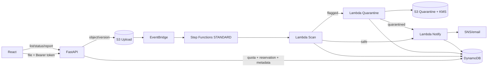

# Thiết kế hệ thống

## Thành phần

| Thành phần | Code | Trách nhiệm |
| --- | --- | --- |
| Frontend | frontend/src/ | Workspace, đăng nhập, hàng đợi upload, báo cáo/thông báo |
| Backend | [main.py](../../backend/app/main.py), routers/, services/ | Xác thực, quyền, quota, metadata, storage, vòng đời, quản trị và chi phí |
| Storage | [storage.py](../../backend/app/services/storage.py), [s3_storage.py](../../backend/app/services/s3_storage.py) | Adapter Local/S3, ghi/đọc/xóa nội dung |
| Metadata | [file_metadata.py](../../backend/app/services/file_metadata.py), [db.py](../../backend/app/db.py) | Khóa, điều kiện cập nhật, phân trang DynamoDB |
| Pipeline | [workflow](../../AWS/Orchestration/State_machine.json), AWS/Lambda_AWS/ | Quét/trích xuất, cách ly, SNS và ghi kết quả |
| Cleanup | [handler](../../AWS/Lambda_AWS/trash_cleanup/handler.py) | Dọn tệp/nhóm thư mục hết hạn bằng lifecycle dùng chung |
| Launcher | launcher/, MaySec.cmd | Cấu hình, kiểm môi trường và quản lý server local |

Frontend gọi FastAPI, không truy cập AWS trực tiếp. Cognito xác định người dùng ứng dụng; principal Boto3 backend/Lambda quyết định quyền hạ tầng.

## Upload và quét

API nhận reservation trước truyền byte. Upload state xác nhận riêng scan state: sự kiện S3 có thể chạy khi API còn hoàn tất bookkeeping. Upload đầu do S3/EventBridge kích hoạt; backend gọi StartExecution trực tiếp cho rescan/phục hồi được yêu cầu.

Workflow truyền execution/version nguồn. Lambda chỉ cập nhật metadata còn tồn tại, đúng owner/key/bucket/version/execution và vòng đời cho phép. pipeline_common.py dùng chung guard execution cũ và dữ liệu đã vào rác/xóa.

Quarantine ghi bằng chứng copy trước xóa đúng version nguồn. Nếu Lambda cách ly và nhánh ghi lỗi không chạy được, PersistQuarantineFailure ghi trạng thái/audit/thông báo bằng transaction DynamoDB. Role workflow cần quyền nhánh này. Quy tắc nghiệp vụ tại [chính sách quét](../policies/scanning.md).

## Đọc và vòng đời

API kiểm quyền/trạng thái trước đọc byte. Safe dùng nguồn; restored dùng đúng version cách ly. Browser nhận NDJSON metadata/base64/end rồi dựng blob; client khác có thể nhận byte trực tiếp. Không trả URL S3 để bỏ qua kiểm quyền API.

Thư mục là metadata partition riêng; di chuyển không đổi key S3. Purge xóa nội dung trước rồi transaction giữ lịch sử/ledger và bỏ metadata sống. Cleanup dùng cùng dịch vụ để giữ quota, chi phí và retry.

## Nhất quán

- Quota dùng lease/token; thư mục dùng revision; tên/vòng đời có timestamp riêng, không ghi đè trạng thái quét.
- Transaction bảo vệ nhóm thay đổi DynamoDB. S3/Cognito/Step Functions không cùng transaction DB; kết quả chưa rõ giữ để đối soát.
- [Thông báo](notifications.md) web bền vững, SNS có bằng chứng riêng.
- [Chi phí](billing.md) dùng ledger/roster, worker đối chiếu khi backend hoạt động.
- Đọc tổng hợp nhiều trang không phải snapshot giao dịch toàn kho. Health báo cấu hình/client/capabilities, không thay nghiệm thu IAM/cloud.

Xem [chế độ chạy](../guides/local-development.md), [khóa/kiểu dữ liệu](../reference/data-model.md).
